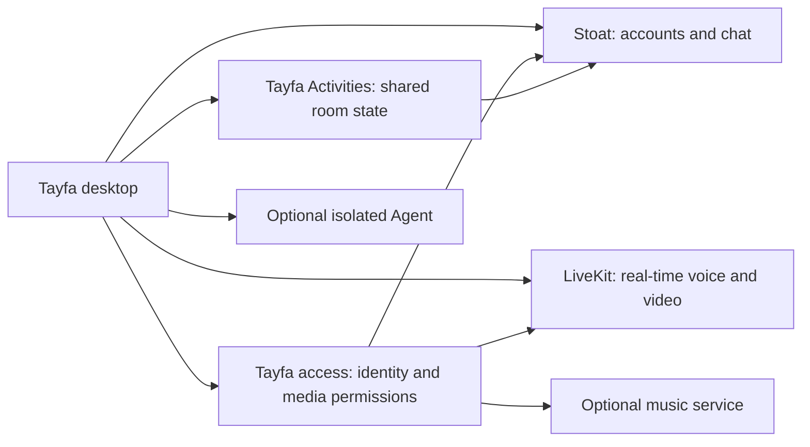
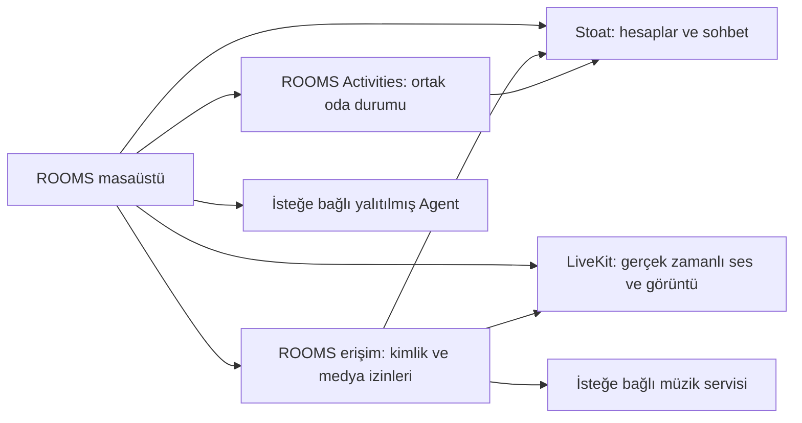

<div align="center">

# Tayfa


### Hang out with your friends. Keep your own server.

[](https://github.com/egemenmermer/rooms/releases/latest)
[](LICENSE)
[](https://github.com/egemenmermer/rooms/releases/download/v0.1.18-rc.34/ROOMS-0.1.18-rc.34-arm64.dmg)
[](https://github.com/egemenmermer/rooms/releases/download/v0.1.18-rc.34/ROOMS-0.1.18-rc.34-windows-x64-setup.exe)

Voice rooms, screen sharing, chat, music and shared activities — in one desktop app.

[Get started](#get-started) · [Screenshots](#screenshots) · [Host your own](docs/SELF_HOSTING.md) · [Docs](#documentation) · **[Türkçe ↓](#türkçe)**

**Self-hosted · Open source · MIT licensed**

</div>

> Tayfa used to be called ROOMS. The installed app's file name and internal identifiers still say ROOMS for now.


## What is Tayfa?

Tayfa is a desktop hangout for a small community. Talk in a voice room, share your screen, chat, and spend time with your friends without leaving the app. The interface is available in English and Turkish (Settings → Appearance → Language).

**You pick the server.** Tayfa is not a service where everyone signs in to one central account or browses a public room directory. A community admin runs the backend on their own server and sends invite links; the link points to that server, and your account belongs to it. The source code contains no built-in personal server address or shared account.

The client uses Electron, React and TypeScript. Accounts and chat run on an unmodified, separately operated **Stoat** backend; real-time voice and video run on **LiveKit**. Tayfa's own services connect these systems and run the shared activities.

## Get started

| You want to                        | Start here                                                            | You need                                                       |
| ---------------------------------- | --------------------------------------------------------------------- | -------------------------------------------------------------- |
| Join an existing community         | [User guide](docs/USER_GUIDE.md) (Turkish)                            | The app and an invite link, or an account on that server       |
| Host your own community            | [One-command install](docs/SELF_HOSTING.md#quick-install-one-command) | A Linux server (VPS) and a domain; the installer does the rest |
| Work on the app                    | [Development guide](docs/DEVELOPMENT.md) (Turkish)                    | Git, Node.js, pnpm and the source code                         |
| Change your community's DJ artwork | [Customization guide](docs/CUSTOMIZATION.md) (Turkish)                | Control over your server's public image files                  |

**Does everyone need to run a server?** No. One admin sets up the community's server; everyone else opens the desktop app and connects to it.

## Download and join a community

Current builds are on the [GitHub releases](https://github.com/egemenmermer/rooms/releases/latest) page. The latest friends-test build is **RC32**:

| Platform                  | Package                                                                                                                             | Status                                                  |
| ------------------------- | ----------------------------------------------------------------------------------------------------------------------------------- | ------------------------------------------------------- |
| macOS 14+ / Apple Silicon | [Download RC34 DMG](https://github.com/egemenmermer/rooms/releases/download/v0.1.18-rc.34/ROOMS-0.1.18-rc.34-arm64.dmg)             | Signed and notarized by Apple                           |
| Windows x64               | [Download RC34 EXE](https://github.com/egemenmermer/rooms/releases/download/v0.1.18-rc.34/ROOMS-0.1.18-rc.34-windows-x64-setup.exe) | Unsigned friends-test build; Windows may show a warning |

1. Download the package for your platform and install the app.
2. Get an invite link (`https://<server>/davet/…`) from your community admin.
3. Open the app. On the **Sign up** tab, paste the link and enter a username, email and password; the link decides the server. If you already have an account on that server, use **Sign in**.
4. Join a chat or a voice room. Grant microphone, camera and screen permissions when you first use each feature.

Downloading the app does not give you membership or an account on any server. Communities that use the same app keep separate accounts and data. A tagged source archive is not an installer.

Mac updates come through the configured Sparkle feed. On Windows, download and install the new EXE. Read the [release notes](https://github.com/egemenmermer/rooms/releases/latest) for version-specific limits and real-device acceptance status. To build from source, follow [the steps below](#run-from-source).

## Screenshots

### Community home

Open your conversations, people and rooms from one place.


### Chat

Message your community and reach room activities from inside the conversation.


### Voice rooms

Join a room, talk, and reach the media controls.


These screenshots come from the real interface with sample community data. They are not a recording of a live call or proof that every optional integration is configured. Labels and layout may change between releases.

## What can you do?

| Area                        | What it does                                                                                | Needs                                                                                                      |
| --------------------------- | ------------------------------------------------------------------------------------------- | ---------------------------------------------------------------------------------------------------------- |
| Community and chat          | Accounts, channels, messages, friends, profiles and roles                                   | A compatible Stoat install and channel/role permissions                                                    |
| Voice and screen share      | Talking, camera and sharing a chosen screen or window                                       | LiveKit, the access service, open media ports and OS permissions                                           |
| Remote control with consent | Mouse and keyboard control with the sharer's approval                                       | Native input component, session authorization and platform permissions; real-device acceptance is separate |
| Shared activities           | Shared tools and server-run game state                                                      | Activities service and persistent storage                                                                  |
| Studio                      | Make music together: shared projects, timeline, piano roll, drum grid, mixer and WAV export | Activities service (Studio module) and persistent storage                                                  |
| Music                       | Community DJ, queue and shared playlists                                                    | Optional music service, supported sources and admin setup                                                  |
| Cinema                      | A community hall that watches the same stream together                                      | Optional cinema service and the owner's own legal source                                                   |
| Personal media              | Media connections you configure for yourself                                                | A supported provider/source and your own authorized access                                                 |
| Server management           | Status and admin work for authorized people                                                 | HostOps setup and separate admin permissions                                                               |
| Agent                       | Optional tasks, progress and results                                                        | Isolated Agent setup, a model connection and explicitly granted permissions                                |

Seeing a screen does not set up its service or provider account. Get chat and voice working first, then add optional services. Provider limits and platform differences apply.

## Run from source

Install **Git**, **Node.js 22.22.0** and **pnpm 11.25.0**. On a Mac you may also need the Xcode Command Line Tools for native components. Platform details are in the [development guide](docs/DEVELOPMENT.md).

```sh
git clone https://github.com/egemenmermer/rooms.git
cd rooms
pnpm install --frozen-lockfile
```

macOS/Linux shell:

```sh
ROOMS_PROFILE=dev-contributor pnpm dev
```

Windows PowerShell:

```powershell
$env:ROOMS_PROFILE = 'dev-contributor'
pnpm dev
```

The app opens with a separate development profile. Paste your invite link on the **Sign up** tab, or enter your community's address on **Sign in**. **Starting the client does not start a backend.** You can open the app without a running community, but you cannot complete real chat and voice flows.

For build, verification and packaging commands, see the [development guide](docs/DEVELOPMENT.md). `pnpm dev:web` in the browser is for interface work only; it does not provide native desktop features. Pass `?lang=en` or `?lang=tr` to pick the interface language there; see [docs/I18N.md](docs/I18N.md) for how translations work.

## Host your own community

With a Linux server (2 GB RAM is enough, 4 GB recommended) and a domain, you can install your own Tayfa server with one command. No domain? A free [DuckDNS](https://www.duckdns.org) name works too.

```sh
curl -fsSL https://raw.githubusercontent.com/egemenmermer/rooms/main/deploy/install.sh | sudo bash
```

The script installs Docker, generates every password on the server, gets an HTTPS certificate automatically, creates the owner account and a first community with a voice channel, and prints your first invite link (`https://your-domain/davet/…`, 7 days, 10 people). Then invite friends with **Create invite** in the app or `sudo rooms invite`. The **Set up your own server** tab on the app's start screen walks through the same steps.

See the [server guide](docs/SELF_HOSTING.md#quick-install-one-command) for details, ports, backups and updates. Music (DJ), the Cinema hall, Agent and the server management panel are optional and not part of the quick install.

## How it works



Electron handles native credentials, screen capture and privileged operations; the interface talks to it through a typed bridge. Voice state is independent of pages, so moving around the app is not meant to end a call. Read the [architecture guide](docs/ARCHITECTURE.md) (Turkish) for boundaries and data ownership.

## Platforms and project status

Tayfa is in active development; the current build is a release candidate. Open source does not mean a finished public V1.

- **macOS 14+ / Apple Silicon:** packaging is set up. Trusted distribution needs signing and Apple notarization.
- **Windows x64:** there is an EXE installer. An unsigned friends-test build is not the same as a trusted signed release.
- **Linux:** not offered as a packaged desktop target; used for the server components.
- **iPhone:** a separate companion project with its own distribution. This repository's desktop package does not install on phones.
- **Automatic updates:** need the distributor's compatible signed package and update feed. A build from source does not join the project owner's channel.
- **Optional integrations:** need their own configuration and acceptance checks. Source tests and the gallery do not prove real-device or provider compatibility.

Before deploying, read the [release guide](docs/RELEASING.md) and [troubleshooting](docs/TROUBLESHOOTING.md) (both Turkish).

## Privacy and customization

The community admin manages their own installation and data. Self-hosting is not end-to-end encryption: media is encrypted in transit; E2EE is not configured. The admin should decide retention, deletion, backup and support policies.

The open client ships an original static DJ illustration. Each community can serve its own name, poster and optional animation without changing source code; see the [customization guide](docs/CUSTOMIZATION.md). Personal provider credentials and private operations files never go into Git.

## Documentation

Most guides are in Turkish for now: [all documents and reading order](docs/README.md) · [RC32 release and verification record](docs/RC32_RELEASE.md)

| Guide                                              | Covers                                                                   |
| -------------------------------------------------- | ------------------------------------------------------------------------ |
| [Usage](docs/USER_GUIDE.md)                        | Joining, accounts, chat, voice, screen sharing and daily use             |
| [Self-hosting](docs/SELF_HOSTING.md)               | Quick install (English and Turkish), services, networking, data, backups |
| [Development](docs/DEVELOPMENT.md)                 | Toolchain, commands, source layout and verification levels               |
| [Architecture](docs/ARCHITECTURE.md)               | Processes, trust boundaries, storage and extension points                |
| [Interface languages](docs/I18N.md)                | How Turkish and English work, glossary and style (English)               |
| [Troubleshooting and FAQ](docs/TROUBLESHOOTING.md) | Install, connection, media and update problems                           |
| [Community roles](docs/COMMUNITY_ROLES.md)         | Custom roles, colors, permissions and limits                             |
| [Remote control](docs/REMOTE_CONTROL.md)           | Request/approval flow, native input and acceptance limits                |
| [Server operations](docs/SERVER_OPERATIONS.md)     | Monitoring, terminal, HostOps and operator permissions                   |
| [Customization](docs/CUSTOMIZATION.md)             | Community-specific DJ artwork and name                                   |
| [Releasing](docs/RELEASING.md)                     | Development packages, signing, update feed and release checks            |
| [Backend integration](infra/stoat/README.md)       | Adapter, registration and upstream acceptance notes                      |
| [Media transport](docs/MEDIA_TRANSPORT.md)         | Design and past verification records                                     |
| [Agent deployment](docs/AGENT_DEPLOYMENT.md)       | Optional isolated Agent infrastructure                                   |
| [Asset register](docs/ASSETS.md)                   | Where images and fonts come from                                         |
| [Third-party notices](docs/THIRD_PARTY_NOTICES.md) | Dependency and upstream licenses                                         |

## Contributing

Issues and focused PRs are welcome, in English or Turkish. Read [CONTRIBUTING.md](CONTRIBUTING.md) before changing contracts between runtimes. In a bug report, include reproduction steps and your platform and version; never include passwords, private messages, invite links or personal media addresses.

For security issues, follow [SECURITY.md](SECURITY.md) instead of opening a public issue.

## License

Original Tayfa code and eligible original assets are [MIT licensed](LICENSE). Dependencies, fonts and separate backend services keep their own licenses. Tayfa's MIT license does not relicense Stoat or third-party media. Original third-party license texts are kept in distributions.

---

## Türkçe

> Tayfa'nın eski adı ROOMS'tur; kurulu uygulamanın dosya adı ve iç tanımlayıcılar şimdilik ROOMS olarak kalıyor.

**Arkadaşlarınla buluş. Sunucun sende kalsın.** Sesli sohbet, ekran paylaşımı, mesajlar, müzik ve ortak etkinlikler — tek masaüstü uygulamasında. Arayüz Türkçe ve İngilizce kullanılabilir (Ayarlar → Görünüm → Dil).

[Başlangıç](#başlangıç) · [Ekran görüntüleri](#uygulamadan-görüntüler) · [Kendi sunucunu kur](docs/SELF_HOSTING.md#türkçe) · [Belgeler](#belgeler) · [English ↑](#tayfa)

### İçindekiler

- [Tayfa nedir?](#tayfa-nedir)
- [Başlangıç](#başlangıç)
- [İndir ve topluluğa katıl](#i̇ndir-ve-topluluğa-katıl)
- [Uygulamadan görüntüler](#uygulamadan-görüntüler)
- [Neler yapabilirsin?](#neler-yapabilirsin)
- [Kaynak koddan çalıştır](#kaynak-koddan-çalıştır)
- [Kendi topluluğunu kur](#kendi-topluluğunu-kur)
- [Nasıl çalışıyor?](#nasıl-çalışıyor)
- [Platformlar ve projenin durumu](#platformlar-ve-projenin-durumu)
- [Gizlilik ve özelleştirme](#gizlilik-ve-özelleştirme)
- [Belgeler](#belgeler)
- [Katkıda bulunma](#katkıda-bulunma)
- [Lisans](#lisans)

### Tayfa nedir?

Tayfa, küçük bir topluluğun masaüstündeki buluşma yeridir. Ses odasında konuşabilir, ekranını paylaşabilir, mesajlaşabilir ve uygulamadan çıkmadan arkadaşlarınla birlikte vakit geçirebilirsin.

**Sunucuyu sen seçersin.** Tayfa, herkesin tek bir merkezî hesapla girdiği veya herkese açık oda dizini sunan bir hizmet değildir. Topluluk yöneticisi arka ucu kendi sunucusunda çalıştırır ve üyelere davet bağlantısı gönderir; bağlantı o sunucuyu gösterir. Hesabın o sunucuya aittir. Kaynak kodda hazır bir kişisel sunucu adresi veya ortak hesap bulunmaz.

İstemci Electron, React ve TypeScript kullanır. Hesaplar ve sohbet için değiştirilmeden, ayrı çalıştırılan **Stoat** arka ucu; gerçek zamanlı ses ve görüntü için **LiveKit** kullanılır. Tayfa servisleri bu sistemleri birbirine bağlar ve ortak etkinlikleri yönetir.

### Başlangıç

| İstediğin                           | Başlangıç noktası                                                   | Gerekenler                                                       |
| ----------------------------------- | ------------------------------------------------------------------- | ---------------------------------------------------------------- |
| Var olan topluluğa katılmak         | [Kullanım rehberi](docs/USER_GUIDE.md)                              | Uyumlu uygulama ve davet bağlantısı veya o sunucuda mevcut hesap |
| Kendi topluluğunu kurmak            | [Tek komutla kurulum](docs/SELF_HOSTING.md#hızlı-kurulum-tek-komut) | Linux sunucu (VPS) ve alan adı; gerisini kurulum betiği yapar    |
| Uygulamayı geliştirmek              | [Geliştirme rehberi](docs/DEVELOPMENT.md)                           | Git, Node.js, pnpm ve kaynak kod                                 |
| Topluluğun DJ görselini değiştirmek | [Özelleştirme rehberi](docs/CUSTOMIZATION.md)                       | Kendi sunucunun herkese açık görsel dosyalarını yönetebilmek     |

**Herkesin sunucu kurması gerekiyor mu?** Hayır. Bir yönetici topluluğun sunucusunu kurar; diğer üyeler masaüstü uygulamasını açıp o sunucuya bağlanır.

### İndir ve topluluğa katıl

Güncel paketler [GitHub sürümleri](https://github.com/egemenmermer/rooms/releases/latest) sayfasındadır. Son yayımlanan arkadaş test sürümü **RC32**:

| Platform                  | Paket                                                                                                                            | Durum                                                    |
| ------------------------- | -------------------------------------------------------------------------------------------------------------------------------- | -------------------------------------------------------- |
| macOS 14+ / Apple Silicon | [RC34 DMG indir](https://github.com/egemenmermer/rooms/releases/download/v0.1.18-rc.34/ROOMS-0.1.18-rc.34-arm64.dmg)             | Apple imzalı ve noter onaylı                             |
| Windows x64               | [RC34 EXE indir](https://github.com/egemenmermer/rooms/releases/download/v0.1.18-rc.34/ROOMS-0.1.18-rc.34-windows-x64-setup.exe) | İmzasız arkadaş test paketi; sistem uyarısı gösterebilir |

1. Platformuna uygun paketi indirip uygulamayı kur.
2. Topluluk yöneticisinden davet bağlantısını (`https://<sunucu>/davet/…`) al.
3. Uygulamayı aç. **Kayıt ol** sekmesinde bağlantıyı yapıştırıp kullanıcı adı, e-posta ve şifreni gir; sunucuyu bağlantı belirler. O sunucuda hesabın varsa **Giriş yap** sekmesini kullan.
4. Bir sohbet ya da ses odasına gir. Mikrofon, kamera ve ekran izinlerini ilgili özelliği kullanırken ver.

Uygulamayı indirmek bir sunucuya üyelik veya hazır hesap sağlamaz. Aynı uygulamayı kullanan farklı toplulukların hesapları ve verileri ayrıdır. Etiketlenmiş kaynak kod arşivi de kurulum paketi değildir.

Mac güncellemeleri yapılandırılmış Sparkle kanalından sunulur. Windows'ta yeni EXE indirilip kurulur. Sürüme özgü sınırlamalar ve gerçek cihaz kabul durumu için [sürüm notlarını](https://github.com/egemenmermer/rooms/releases/latest) oku. Kaynaktan derlemek istersen [aşağıdaki adımları](#kaynak-koddan-çalıştır) izle.

### Uygulamadan görüntüler

#### Topluluk ana sayfası

Konuşmalarını, kişileri ve odaları aynı yerden aç.


#### Sohbet

Topluluğunla mesajlaş; odadaki etkinliklere konuşmanın içinden ulaş.


#### Ses odaları

Bir odaya katıl, konuş ve medya kontrollerine ulaş.


Bu görüntüler, uygulamanın gerçek arayüzünden örnek topluluk verileriyle alınmıştır. Canlı görüşme kaydı veya her isteğe bağlı entegrasyonun yapılandırıldığına dair kanıt değildir. Etiketler ve ekran düzeni sürümler arasında değişebilir.

### Neler yapabilirsin?

| Alan                   | Ne işe yarar?                                                                                           | Gereken altyapı                                                                               |
| ---------------------- | ------------------------------------------------------------------------------------------------------- | --------------------------------------------------------------------------------------------- |
| Topluluk ve sohbet     | Hesap, kanal, mesaj, arkadaşlık, profil ve rol yönetimi                                                 | Uyumlu Stoat kurulumu ve kanal/rol izinleri                                                   |
| Ses ve ekran paylaşımı | Konuşma, kamera ve seçilen ekran/pencere yayını                                                         | LiveKit, erişim servisi, açık medya portları ve işletim sistemi izinleri                      |
| İzinli uzaktan kontrol | Yayıncının onayıyla fare ve klavye kontrolü                                                             | Yerel giriş bileşeni, oturum yetkisi ve platform izinleri; gerçek cihaz kabulü ayrıca gerekir |
| Ortak etkinlikler      | Paylaşılan araçlar ve sunucunun yönettiği oyun durumu                                                   | Activities servisi ve kalıcı depolama                                                         |
| Stüdyo                 | Birlikte müzik: ortak proje, zaman çizelgesi, piyano rulosu, davul ızgarası, mikser ve WAV dışa aktarma | Activities servisi (Stüdyo modülü) ve kalıcı depolama                                         |
| Müzik                  | Topluluk DJ'i, kuyruk ve ortak listeler                                                                 | İsteğe bağlı müzik servisi, desteklenen kaynaklar ve yönetici yapılandırması                  |
| Kişisel medya          | Sana ait yapılandırılmış medya bağlantıları                                                             | Desteklenen sağlayıcı/kaynak ve kendi yetkili erişimin                                        |
| Sunucu yönetimi        | Yetkili kişinin sunucu durumu ve yönetim işlerini izlemesi                                              | HostOps kurulumu ve ayrı yönetici yetkileri                                                   |
| Agent                  | İsteğe bağlı görevler, ilerleme ve sonuçlar                                                             | Yalıtılmış Agent kurulumu, model bağlantısı ve açıkça verilmiş yetkiler                       |

Bir ekranın görünmesi o servisi veya sağlayıcı hesabını kendiliğinden kurmaz. Önce temel sohbet ve sesi çalıştır; isteğe bağlı servisleri daha sonra ekle. Sağlayıcı kısıtları ve platform farkları geçerlidir.

### Kaynak koddan çalıştır

**Git**, **Node.js 22.22.0** ve **pnpm 11.25.0** kur. Mac'te yerel bileşenler için Xcode Command Line Tools da gerekebilir. Platform ayrıntıları [geliştirme rehberindedir](docs/DEVELOPMENT.md).

```sh
git clone https://github.com/egemenmermer/rooms.git
cd rooms
pnpm install --frozen-lockfile
```

macOS/Linux kabuğunda:

```sh
ROOMS_PROFILE=dev-contributor pnpm dev
```

Windows PowerShell'de:

```powershell
$env:ROOMS_PROFILE = 'dev-contributor'
pnpm dev
```

Uygulama ayrı geliştirme profiliyle açılır. **Kayıt ol** sekmesine davet bağlantını yapıştır veya **Giriş yap** sekmesinde topluluğunun adresini gir. **İstemciyi başlatmak arka ucu başlatmaz.** Çalışan bir topluluk olmadan uygulamayı açabilirsin; gerçek sohbet ve ses akışlarını tamamlayamazsın.

Derleme, doğrulama ve paket komutları için [geliştirme rehberine](docs/DEVELOPMENT.md) bak. Tarayıcıdaki `pnpm dev:web`, arayüz çalışmaları içindir; yerel masaüstü özelliklerini sağlamaz.

### Kendi topluluğunu kur

Bir Linux sunucu (2 GB RAM yeterli, 4 GB önerilir) ve bir alan adı ile kendi Tayfa sunucunu tek komutla kurabilirsin. Alan adın yoksa ücretsiz bir [DuckDNS](https://www.duckdns.org) adı da işe yarar.

```sh
curl -fsSL https://raw.githubusercontent.com/egemenmermer/rooms/main/deploy/install.sh | sudo bash
```

Betik Docker'ı kurar, tüm parolaları sunucuda üretir, HTTPS sertifikasını otomatik alır, sahip hesabını ve ilk topluluğu ses kanalıyla oluşturur ve ilk davet bağlantını (`https://alan-adin/davet/…`, 7 gün, 10 kişi) verir. Sonra arkadaşlarını uygulamadaki **Davet oluştur** veya `sudo rooms invite` ile davet edersin. Uygulamanın başlangıç ekranındaki **Kendi sunucunu kur** sekmesi de bu adımları kısaca gösterir.

Ayrıntılar, portlar, yedekleme ve güncelleme için [sunucu rehberine](docs/SELF_HOSTING.md#hızlı-kurulum-tek-komut) bak. Müzik (DJ), Sinema salonu, Agent ve sunucu yönetim paneli isteğe bağlıdır ve hızlı kuruluma dahil değildir.

### Nasıl çalışıyor?



Yerel kimlik bilgilerini, ekran yakalamayı ve yetkili işlemleri Electron yönetir. Arayüz, tipli bir köprü kullanır. Ses durumu sayfalardan bağımsızdır; uygulama içinde başka yere geçmek görüşmeyi sonlandırmak için tasarlanmamıştır. Sınırlar ve veri sahipliği için [mimari rehberini](docs/ARCHITECTURE.md) oku.

### Platformlar ve projenin durumu

Tayfa aktif geliştirme aşamasındadır; güncel sürüm bir yayın adayıdır. Kaynağın açık olması, tamamlanmış bir herkese açık V1 olduğu anlamına gelmez.

- **macOS 14+ / Apple Silicon:** paketleme yapılandırılmıştır. Güvenilir dağıtım için imza ve Apple noter onayı gerekir.
- **Windows x64:** EXE kurulumu vardır. İmzasız arkadaş test paketi ile güvenilir imzalı yayın farklıdır.
- **Linux:** paketli masaüstü yayın hedefi olarak sunulmaz; sunucu bileşenleri için kullanılır.
- **iPhone:** ayrı eşlikçi projesi ve dağıtımı vardır. Bu deponun masaüstü paketi telefona kurulum sağlamaz.
- **Otomatik güncelleme:** dağıtıcının uyumlu imzalı paketi ve güncelleme beslemesi gerekir. Kaynak koddan alınan derleme kendiliğinden proje sahibinin kanalına katılmaz.
- **İsteğe bağlı entegrasyonlar:** kendi yapılandırmalarını ve kabul kontrollerini gerektirir. Kaynak testleri ve galeri, gerçek cihaz veya sağlayıcı uyumluluğunu kanıtlamaz.

Dağıtımdan önce [sürüm rehberini](docs/RELEASING.md) ve [sorun gidermeyi](docs/TROUBLESHOOTING.md) oku.

### Gizlilik ve özelleştirme

Topluluk yöneticisi kendi kurulumunu ve verisini yönetir. Kendi sunucunda çalıştırmak uçtan uca şifreleme anlamına gelmez: medya aktarım sırasında şifrelenir; E2EE yapılandırılmış değildir. Saklama, silme, yedekleme ve destek politikalarını yönetici belirlemelidir.

Açık istemcide özgün bir statik DJ çizimi bulunur. Her topluluk kendi adını, posterini ve isteğe bağlı animasyonunu kaynak kodu değiştirmeden sunabilir. [Özelleştirme rehberine](docs/CUSTOMIZATION.md) bak. Kişisel sağlayıcı kimlik bilgileri ve özel operasyon dosyaları Git'e konmaz.

### Belgeler

[Tüm belgeler ve okuma sırası](docs/README.md) · [RC32 yayın ve doğrulama kaydı](docs/RC32_RELEASE.md)

| Rehber                                                     | İçeriği                                                               |
| ---------------------------------------------------------- | --------------------------------------------------------------------- |
| [Kullanım](docs/USER_GUIDE.md)                             | Katılım, hesap, sohbet, ses, ekran paylaşımı ve günlük kullanım       |
| [Sunucu kurulumu](docs/SELF_HOSTING.md)                    | Servisler, yerel kurulum, dış ağ, veriler, yedek ve doğrulama         |
| [Geliştirme](docs/DEVELOPMENT.md)                          | Araç zinciri, komutlar, kaynak düzeni ve doğrulama seviyeleri         |
| [Mimari](docs/ARCHITECTURE.md)                             | Süreçler, güven sınırları, depolama ve genişletme noktaları           |
| [Sorun giderme ve sık sorulanlar](docs/TROUBLESHOOTING.md) | Kurulum, bağlantı, medya ve güncelleme sorunları                      |
| [Topluluk rolleri](docs/COMMUNITY_ROLES.md)                | Özel roller, renkler, izinler ve yetki sınırları                      |
| [Uzaktan kontrol](docs/REMOTE_CONTROL.md)                  | İstek/onay akışı, yerel giriş ve kabul sınırları                      |
| [Sunucu yönetimi](docs/SERVER_OPERATIONS.md)               | İzleme, terminal, HostOps ve operatör yetkileri                       |
| [Özelleştirme](docs/CUSTOMIZATION.md)                      | Topluluğa özel DJ görseli ve adı                                      |
| [Sürüm yayımlama](docs/RELEASING.md)                       | Geliştirme paketleri, imza, güncelleme beslemesi ve yayın kontrolleri |
| [Arka uç entegrasyonu](infra/stoat/README.md)              | Bağdaştırıcı, kayıt ve üst sistem kabul notları                       |
| [Medya aktarımı](docs/MEDIA_TRANSPORT.md)                  | Tasarım ve geçmiş doğrulama kayıtları                                 |
| [Agent kurulumu](docs/AGENT_DEPLOYMENT.md)                 | İsteğe bağlı izole Agent altyapısı                                    |
| [Varlık kaydı](docs/ASSETS.md)                             | Görsellerin ve yazı tiplerinin kaynağı                                |
| [Üçüncü taraf bildirimleri](docs/THIRD_PARTY_NOTICES.md)   | Bağımlılık ve üst sistem lisansları                                   |

### Katkıda bulunma

Issue ve odaklı PR'lara açığız. Çalışma ortamları arasındaki sözleşmeleri değiştirmeden önce [CONTRIBUTING.md](CONTRIBUTING.md) belgesini oku. Hata bildirimine yeniden üretim adımlarını ve ilgili platform/sürüm bilgisini ekle; parola, özel mesaj, davet bağlantısı ve kişisel medya adreslerini ekleme.

Güvenlik açıklarında herkese açık issue yerine [SECURITY.md](SECURITY.md) yolunu izle.

### Lisans

Özgün Tayfa kodu ve uygun özgün varlıklar [MIT lisanslıdır](LICENSE). Bağımlılıklar, yazı tipleri ve ayrı arka uç servisleri kendi lisanslarını korur. Tayfa'nın MIT lisansı Stoat'ı veya üçüncü taraf medyayı yeniden lisanslamaz. Üçüncü taraf lisanslarının özgün metinleri dağıtımlarda korunur.
